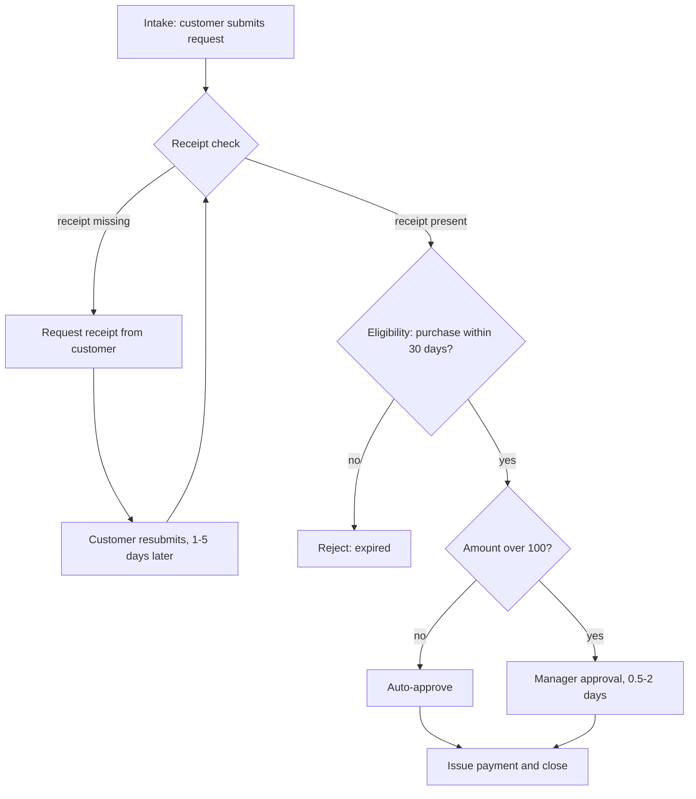
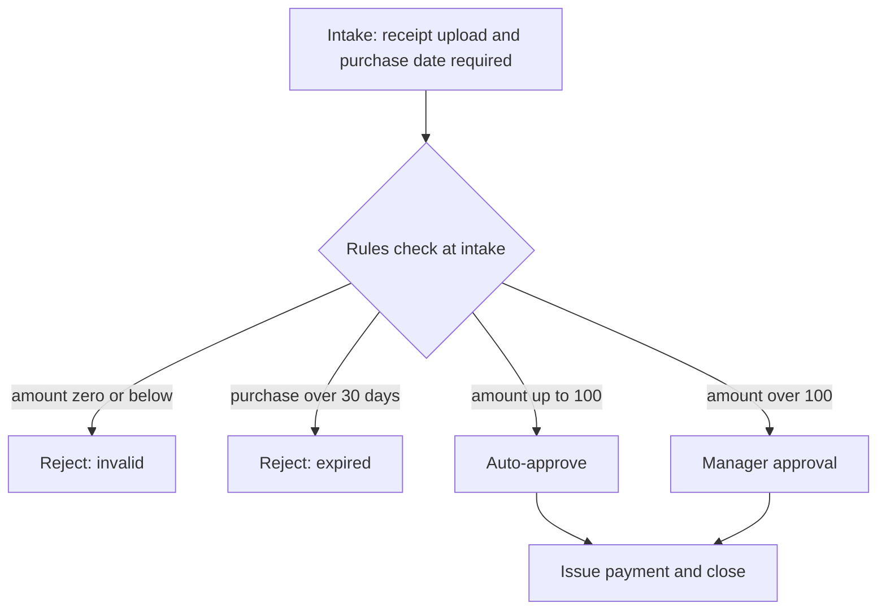

# Process Assessment: Refund Requests

Assessment of a simulated refund-request process. The event log is simulated
(`simulate_log.py`); every figure below comes from `analyze_process.py` on that log.

## As-is process

## Findings

| Measure | Value |
|---|---|
| Cases | 1,000 |
| Mean cycle time, all cases | 1.48 days |
| Cases that loop back for a receipt | 30.1% |
| Mean cycle time, looped cases | 3.53 days |
| Mean cycle time, cases with no loop | 0.60 days |
| Mean time spent waiting on the customer in the loop | 2.88 days |
| Cases rejected as expired | 49.3% |

**Main inefficiency: the receipt loop.** Intake does not ask for a receipt, so 30% of
cases reach the receipt check without one. Each of those then waits for the customer to
resubmit. A looped case takes about six times as long as one without a loop, and the
wait is almost entirely spent waiting on the customer, not on staff.

**Secondary inefficiency: expired requests reach staff.** About half of all requests
are older than the 30-day window. The eligibility rule rejects them, but only after
intake and the receipt check. Some of these expired cases also go through the receipt
loop before being rejected. Intake has no purchase-date field, so the rule cannot run
earlier.

## Future state

The receipt check and the rework loop are removed. Eligibility runs at intake, using
the same decision table (`rules/refund_rules.csv`), so a request that cannot be
approved is rejected before any staff time is spent.

**Expected effect, modeled on the simulated log.** If each looped case had been
complete at intake, mean cycle time would drop from 1.48 to 0.61 days, saving about
0.87 days per case. This is the counterfactual of the simulation, not a forecast for a
real operation. Confirm it with a pilot: run the new intake for two weeks in one team,
and compare cycle time and bounce rate against a control team.

## Business rules

The decision logic is captured in `rules/refund_rules.csv`, a version-controlled table
that lives on after this assessment. `rules/evaluate.py` applies it, and
`tests/test_rules.py` checks that every combination of amount, receipt, and age gets a
decision. Changing a policy means editing one row and running the tests.

| Rule | Condition | Decision |
|---|---|---|
| R01 | Amount is zero or negative | Reject: invalid |
| R02 | No receipt | Request receipt |
| R03 | Purchase older than 30 days | Reject: expired |
| R04 | Amount up to 100, receipt, within 30 days | Auto-approve |
| R05 | Amount over 100, receipt, within 30 days | Manager approval |

## Open questions for the process owner

- Is 30 days the policy window for all product lines, or only for refunds?
- Who owns the decision table after this engagement? The table needs an owner so it
  does not drift from the policy.
- Should expired requests still be logged, for reporting on how many customers
  submit late?
